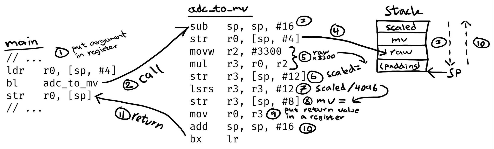

+++
title = "Do you need to know assembly?"
date = 2026-09-10
+++

I rarely write assembly.

Never, really.

The compiler does it better, and writing it is more tedious than hard anyway.

Reading it, on the other hand, is often a good way to understand what's going on.

```c
uint32_t adc_to_mv(uint32_t raw) {
    uint32_t scaled = raw * 3300;
    uint32_t mv = scaled / 4096;
    return mv;
}

int main(void) {
    // ...
    uint32_t raw = adc_read();
    uint32_t voltage = adc_to_mv(raw);
    // ...
}
```

This code turns a raw reading into millivolts. But what is the machine really doing?



Once you understand what the machine is doing, many things start to make more sense:

- A local variable without an initial value may contain garbage because its stack slot holds whatever was already there.
- Nested calls can overflow the stack because each one sets aside space and holds it until it returns.
- A pointer to a local variable is invalid once a function returns, because that space on the stack may now be used by something else.
- ...

A useful exercise is to pick something small and read the assembly it compiles to. Start with no compiler optimization (-O0). I like godbolt.org for this, or better yet, step through it on your own target and use the debugger to follow the registers and stack.
