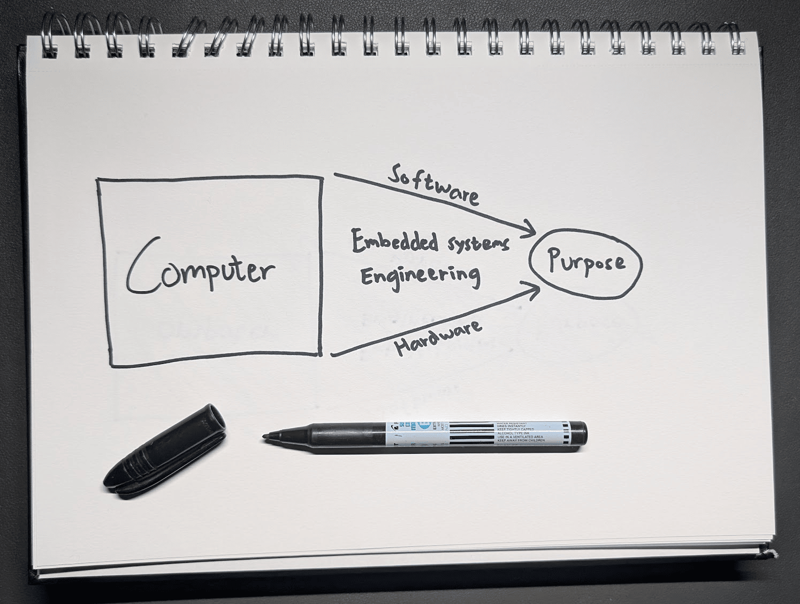
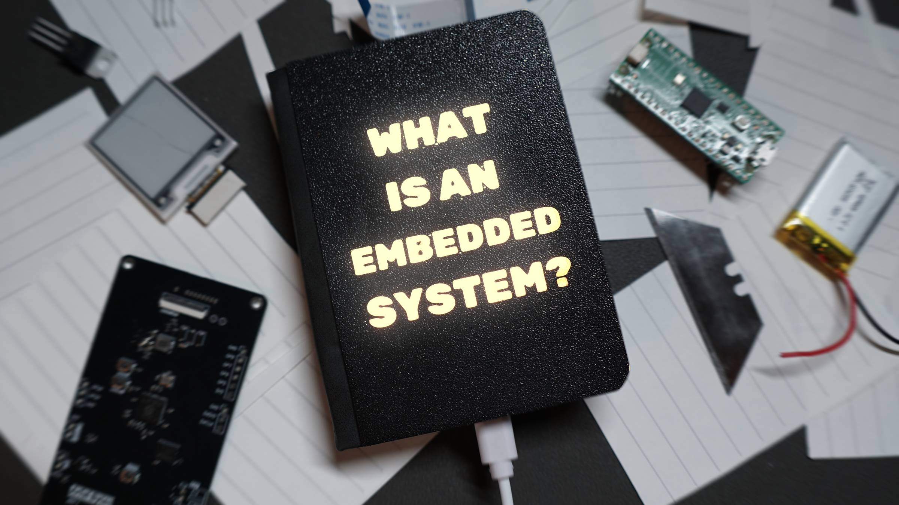

+++
title = "What embedded systems are really about"
date = 2026-03-08
+++

If you look up what an embedded system is, you’ll usually find something like this:

*“An embedded system is a computer system with a dedicated function within a larger mechanical or electrical system...”*

In short, a computer with a purpose.

That's vague enough that people end up arguing about what counts.

A digital alarm clock? Sure.

A desktop PC? No.

A smartphone? Don’t get me started.

But arguing about definitions only gets you so far and kind of misses the point.

The point is **why** we even talk about embedded systems in the first place.

It's because the moment a computer system is given a purpose, when it doesn't have to do everything, the way we design it changes.

We can then shape its hardware and software for that specific purpose.

Making it smaller.\
Cheaper.\
Faster.\
More reliable.

And this opens up a different kind of engineering.

The kind used to build systems\
that run factories,\
power cars,\
fly planes\
and make the world around us behave the way we want it to.

The kind we call\
Embedded systems engineering.

---

*I explain this with a physical example in my latest video.*

